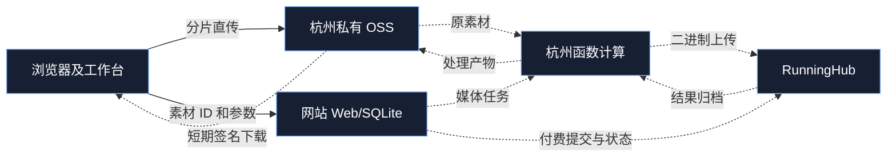

# 媒体链路架构

状态标记沿用工作区 `HANDOFF.md`：`[verified]` 已在本地证实，`[inferred]` 设计推导，`[unknown]` 待联调。

- [verified] 当前正式业务仍使用本地 `StagedAsset.relative_path`、本地媒体 Worker/Windows 节点和网站文件下载。新 OSS 路由默认关闭，且尚未接入付费预检。
- [verified] `MediaAsset` 是独立的私有 OSS 对象及分片会话记录，`object_key` 不作为本机 `Path` 解析。
- [verified] 上传完成会建立唯一 `MediaVerificationJob`；独立令牌保护云端领取、续租和回执。FC 一次运行领取一单，凭执行角色临时凭据从杭州 OSS 内网读取，在本地临时目录计算 SHA-256 并用 FFprobe/FFmpeg 检查，向网站仅回传元数据。当前未部署或配置 FC 触发器。
- [inferred] 目标拓扑如下；虚线所示的实际云端触发、处理/归档交接尚未完成，不能切换生产。

网站上传会话的 OSS 控制请求暂走公网 HTTPS Endpoint（请求很小，便于旧服务器灰度），客户端签名也用公网 Endpoint；未来 FC 同地域读取才使用内网 Endpoint。网站不接收新协议的文件正文。当前旧 multipart 接口仍在；停用时必须先完成所有业务与客户端改造。
